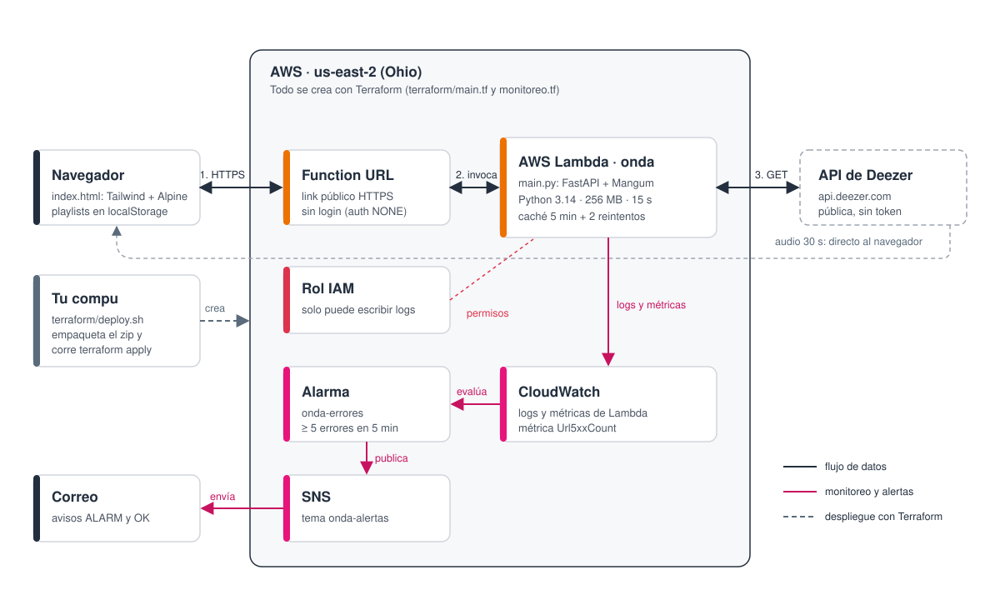

# Onda

Reproductor de música web hecho con la API pública de Deezer y desplegado en AWS Lambda.

## 1. Qué es

Una página para buscar canciones y artistas, escuchar vistas previas de 30 segundos y armar tus propias playlists.

Hecha con FastAPI (Python) en el backend y Tailwind con Alpine.js en la interfaz.

## 2. Cómo funciona en AWS



La app corre en **AWS Lambda**: solo se ejecuta cuando alguien entra y se accede con un link público (**Function URL**). Si la app empieza a fallar, una alarma de **CloudWatch** lo detecta y **SNS** avisa por correo.

Toda la infraestructura está escrita con **Terraform** en `terraform/`, y `terraform/deploy.sh` la crea o actualiza con un solo comando, sin usar la consola de AWS.

Documentación completa: [docs/documentacion.md](docs/documentacion.md).

## 3. Cómo tenerlo en tu computadora

Algunas carpetas no están en el repositorio porque se generan solas o tienen datos de la cuenta de AWS: `.venv/`, `terraform/.terraform/` y `terraform.tfstate`. Estos pasos las crean de nuevo.

**Requisitos:** Git, Python 3.12 o superior y `zip`. Para desplegar también necesitas [Terraform](https://developer.hashicorp.com/terraform/install), [AWS CLI v2](https://docs.aws.amazon.com/cli/latest/userguide/getting-started-install.html) y una cuenta de AWS. Los comandos son para macOS o Linux; en Windows usa WSL.

### Correrlo en local

```bash
git clone https://github.com/HugoTrejo13/dezeer-api.git
cd dezeer-api

python3 -m venv .venv
.venv/bin/pip install -r requirements.txt

.venv/bin/uvicorn main:app --reload
```

Abre `http://localhost:8000` para la app y `http://localhost:8000/docs` para los endpoints. Detén el servidor con `Ctrl + C`.

### Desplegarlo en tu propia cuenta de AWS

```bash
aws login                                                  # o: aws configure
cp terraform/terraform.tfvars.example terraform/terraform.tfvars
# edita terraform/terraform.tfvars y pon tu correo para las alertas
terraform/deploy.sh                                        # empaqueta y crea todo; escribe "yes"
terraform -chdir=terraform output url                      # tu link
```

Después confirma la suscripción en el correo que te manda AWS; sin eso no llegan las alertas.

Como `terraform.tfstate` no está en el repositorio, Terraform crea recursos nuevos en tu cuenta. El estado se guarda en tu computadora, en `terraform/terraform.tfstate`.

### Actualizar después de cambiar el código

```bash
terraform/deploy.sh
```

### Probar la resiliencia

```bash
.venv/bin/python tests/resiliencia.py URL                                # app normal
terraform/deploy.sh -var deezer_url=https://api.deezer.invalid           # simula que Deezer se cae
.venv/bin/python tests/resiliencia.py URL --falla                        # errores controlados y alarma
terraform/deploy.sh                                                      # vuelve a la normalidad
```

### Borrar todo de AWS

```bash
terraform -chdir=terraform destroy
```
