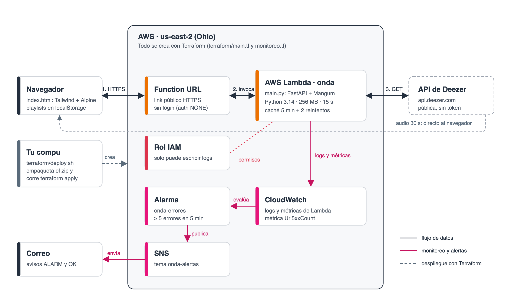

# Onda: reproductor de música en AWS Lambda

**Proyecto Final · Cómputo en la Nube · 2026B**
**Integrantes:** [nombres]
**Repositorio:** https://github.com/HugoTrejo13/dezeer-api
**Aplicación:** https://i4y2vqax4fdnjnakpsnpsw4xje0lgenc.lambda-url.us-east-2.on.aws/

---

## 1. Descripción del proyecto

Onda es una **aplicación web** para buscar canciones y artistas, escuchar vistas previas de 30 segundos y armar playlists propias. El catálogo viene de la API pública de Deezer, y la aplicación corre en AWS Lambda.

| Parte | Archivo | Tecnología |
|---|---|---|
| Interfaz | `static/index.html` | HTML, Tailwind CSS y Alpine.js |
| Backend | `main.py` | Python 3.14, FastAPI, httpx y Mangum |
| Infraestructura | `terraform/main.tf`, `terraform/monitoreo.tf` | Terraform con el proveedor oficial de AWS |
| Despliegue | `terraform/deploy.sh` | Script de shell |
| Pruebas | `tests/resiliencia.py` | Python y httpx |

**¿Por qué hace falta un backend?** La API de Deezer no envía la cabecera `Access-Control-Allow-Origin`, así que el navegador bloquea las llamadas directas (CORS). El backend en Lambda consulta a Deezer, deja solo los datos que usa la interfaz y se los devuelve al navegador.

**Límites que impone Deezer:**
- La API pública solo entrega extractos de 30 segundos de cada canción.
- Crear playlists dentro de Deezer requiere OAuth con la cuenta del usuario, así que las playlists de Onda se guardan en el navegador (`localStorage`).

---

## 2. Guía de despliegue

Toda la infraestructura se crea con un script y una plantilla de Terraform. La consola de AWS solo se usa para **observar** (métricas, alarmas y costos), nunca para crear recursos.

### 2.1 Requisitos

- Una cuenta de AWS, con MFA activado en el usuario principal.
- [AWS CLI v2](https://docs.aws.amazon.com/cli/latest/userguide/getting-started-install.html) y [Terraform](https://developer.hashicorp.com/terraform/install).
- Git, Python 3.12 o superior y `zip`.
- macOS o Linux. En Windows hay que usar WSL.

### 2.2 Desplegar desde cero

```bash
# 1. Descargar el proyecto
git clone https://github.com/HugoTrejo13/dezeer-api.git
cd dezeer-api

# 2. Iniciar sesión en AWS (abre el navegador)
aws login

# 3. Poner el correo que recibirá las alertas
cp terraform/terraform.tfvars.example terraform/terraform.tfvars
#    edita terraform/terraform.tfvars:  alert_email = "tu-correo@ejemplo.com"

# 4. Empaquetar y crear toda la infraestructura (escribe "yes" para confirmar)
terraform/deploy.sh

# 5. Ver el link de la aplicación
terraform -chdir=terraform output url
```

`deploy.sh` hace todo en orden:
1. Crea el entorno de Python (`.venv`) si no existe.
2. Descarga las librerías **en su versión para Linux**, que es donde corre Lambda.
3. Arma `dist/onda-lambda.zip` con fechas fijas, de modo que el mismo código siempre genera el mismo zip.
4. Ejecuta `terraform init` y `terraform apply`.

**Después del despliegue**, AWS manda un correo *"Subscription Confirmation"*. Hay que dar clic en **Confirm subscription**, o las alertas no llegan.

### 2.3 Comprobar que funciona

```bash
.venv/bin/python tests/resiliencia.py https://<tu-url>.lambda-url.us-east-2.on.aws
```

### 2.4 Actualizar y eliminar

```bash
terraform/deploy.sh                       # después de cambiar el código
terraform -chdir=terraform destroy        # borra todos los recursos de AWS
```

### 2.5 Recursos que se crean

| # | Recurso de Terraform | Nombre en AWS | Para qué sirve |
|---|---|---|---|
| 1 | `aws_iam_role` | `onda-lambda-role` | Identidad de la función |
| 2 | `aws_iam_role_policy_attachment` | `AWSLambdaBasicExecutionRole` | Permiso mínimo: escribir logs |
| 3 | `aws_lambda_function` | `onda` | Ejecuta `main.py` |
| 4 | `aws_lambda_function_url` | link `…lambda-url.us-east-2.on.aws` | Link público HTTPS |
| 5 | `aws_sns_topic` | `onda-alertas` | Canal de avisos |
| 6 | `aws_sns_topic_subscription` | correo | Entrega los avisos por email |
| 7 | `aws_cloudwatch_metric_alarm` | `onda-errores` | Detecta 5 o más errores 5xx en 5 minutos |

> **Captura:** terminal con `terraform -chdir=terraform state list` mostrando los 7 recursos.

---

## 3. Diagrama de arquitectura



### Flujo de datos
1. El **navegador** abre la Function URL por HTTPS.
2. La **Function URL** invoca a **Lambda**. Lambda ejecuta FastAPI a través de Mangum, que traduce el evento de AWS a una petición web.
3. Lambda entrega la página o, para las rutas `/api/...`, consulta la **API de Deezer**, filtra el JSON y lo devuelve.
4. Para el audio, `/api/preview/{id}` responde con una redirección, y el navegador descarga el mp3 de 30 s **directo de Deezer**. Así, el audio no pasa por Lambda ni genera costo.

### Flujo de monitoreo
1. Lambda envía automáticamente sus logs y métricas a **CloudWatch**.
2. La alarma `onda-errores` revisa la métrica `Url5xxCount` cada 5 minutos.
3. Si hay 5 o más errores, la alarma pasa a **ALARM** y publica en el tema de **SNS**.
4. SNS envía el correo. Cuando los errores paran, la alarma vuelve a **OK** y llega otro correo.

### Flujo de despliegue
`deploy.sh` empaqueta el código, y Terraform compara `main.tf` y `monitoreo.tf` con lo que existe en AWS. Después crea, cambia o borra solo lo necesario.

### Función de cada servicio de AWS

| Servicio | Función en Onda |
|---|---|
| **AWS Lambda** | Ejecuta el backend solo cuando llega una petición |
| **Function URL** | Da el link público HTTPS de la función, sin servidor ni API Gateway |
| **IAM** | Le da a la función el permiso mínimo que necesita: escribir logs |
| **CloudWatch** | Guarda logs y métricas, y la alarma detecta errores |
| **SNS** | Envía por correo los avisos de la alarma |

---

## 4. Justificación de decisiones

| Decisión | Alternativas | Por qué |
|---|---|---|
| **Lambda** | EC2, Elastic Beanstalk, App Runner | La app solo trabaja cuando alguien la usa. Lambda cobra por petición y por milisegundo, mientras que un `t3.micro` en Ohio cuesta $0.0104 por hora, unos **$91 al año** aunque nadie entre. Además, Lambda no requiere administrar un sistema operativo. |
| **Function URL** | API Gateway | La app expone una sola función, y Function URL da HTTPS sin otro servicio ni costo extra. API Gateway convendría si hicieran falta límites por usuario, llaves o un dominio propio. |
| **FastAPI + Mangum** | Flask, una función Lambda por ruta | El mismo código corre en local con `uvicorn` y en Lambda con Mangum. Además, FastAPI valida parámetros y genera la documentación `/docs` automáticamente. |
| **Sin base de datos** | DynamoDB, RDS | Los datos vienen de Deezer y las playlists se guardan en el navegador, así que no hay nada que guardar en el servidor. Eso hace a la función *stateless*, más simple y más barata. |
| **CloudWatch + SNS** | Revisar logs a mano | Sin alarma, una falla de Deezer solo se nota cuando un usuario se queja. La alarma la detecta en minutos y SNS avisa por correo. |
| **Terraform + `deploy.sh`** | Consola, CloudFormation, CDK | La infraestructura queda como código: se lee, se versiona en Git y se recrea igual con un comando. Terraform muestra el plan antes de aplicarlo, y su sintaxis es más corta que la de CloudFormation. |
| **Región us-east-2 (Ohio)** | us-east-1, otras | Está en Norteamérica, tiene precios bajos y Deezer responde bien desde ahí. |

### Ventajas que encontramos
- **Costo casi cero:** en noviembre usamos el 0.01 % de la capa gratuita de Lambda (ver sección 6).
- **Escala sola:** Lambda crea instancias según la demanda, sin configurar nada.
- **Recrear todo es rápido:** `destroy` y `deploy.sh` reconstruyeron los recursos desde cero en alrededor de un minuto.
- **Alertas sin servidor propio:** CloudWatch y SNS avisaron de la falla simulada unos 2 minutos después de que empezó.

### Desventajas que encontramos
- **Arranque en frío:** la primera visita tras un rato sin uso tardó **2.7 s**, mientras que las siguientes peticiones tardaron entre 0.1 y 0.6 s.
- **Límite de concurrencia de la cuenta:** las cuentas nuevas permiten **10 instancias simultáneas**. Con 30 peticiones al mismo tiempo, 16 recibieron un 429. Ese límite se puede ampliar con una solicitud a AWS.
- **Empaquetado entre sistemas:** las librerías instaladas en macOS no sirven en Lambda, que corre en Linux. `deploy.sh` las descarga para Linux de forma explícita.
- **La URL no es amigable** y cambia si se destruye la función. Un dominio propio requeriría CloudFront o API Gateway y Route 53.
- **El caché vive en cada instancia** y se pierde con un arranque en frío.
- **El estado de Terraform es local** (`terraform.tfstate`). En equipo convendría guardarlo en S3.

---

## 5. Pruebas de resiliencia

Las pruebas están automatizadas en `tests/resiliencia.py`. La falla principal se simuló **en la nube** con Terraform, desplegando la función con una URL de Deezer que no existe.

### 5.1 Qué pasa si falla cada componente

| Componente que falla | Qué pasaría | Cómo lo maneja Onda | ¿Se probó? |
|---|---|---|---|
| **Deezer no responde** | Sin datos de canciones | 2 reintentos de conexión. Si hay una copia en caché, la usa; si no, responde **502 controlado** y la interfaz muestra "No se pudo cargar esta página" con el botón **Reintentar**. La alarma avisa por correo. | **Sí, en la nube** (5.3) |
| **Deezer limita las peticiones** (error 4 QUOTA o 700 SERVICE_BUSY) | Respuestas con error | Usa la última copia guardada. El caché de 5 min también reduce las llamadas a Deezer. | Sí, en local con respuestas simuladas |
| **Deezer está lento** | La página se queda cargando | `httpx` corta a los **10 s**, antes del límite de **15 s** de Lambda, y responde 502 controlado en vez de un timeout de Lambda. | Por diseño |
| **Datos inválidos o inexistentes** | Errores 500 | FastAPI valida los parámetros (**422**), y el error 800 de Deezer se convierte en **404**. | Sí |
| **Muchas peticiones a la vez** | Saturación o costo alto | Lambda escala hasta el límite de la cuenta (10) y rechaza el exceso con **429** sin caerse. | Sí, 30 simultáneas |
| **La URL del audio caduca** (Deezer la vence a los 15 min) | El audio deja de sonar | `/api/preview/{id}` pide una URL nueva en cada reproducción. | Sí (307) |
| **Arranque en frío** | Primera carga lenta | La espera se tolera (2.7 s), y el caché acelera las siguientes. | Sí |
| **Cae la región us-east-2** | La app deja de estar disponible | AWS ya reparte Lambda en varias zonas de disponibilidad dentro de la región. Si cae la región completa, como la app no guarda datos, se puede desplegar en otra región cambiando `region` en `main.tf`, con un estado de Terraform nuevo y otro nombre de rol, porque IAM es global. | No, solo se describe |
| **Se pierde `terraform.tfstate`** | Terraform ya no sabe qué creó | La app sigue funcionando. El control se recupera con `terraform import`, y la mejora es guardar el estado en S3. | No, solo se describe |

### 5.2 Funcionamiento normal en la nube (18 nov)

```
   Escenario                                      Ruta                   Esperado  Obtenido        Tiempo
✓  Página principal                               /                      200       200             2683 ms
✓  Primera petición (puede ser arranque en frío)  /api/home              200       200             541 ms
✓  Misma petición en caliente                     /api/home              200       200             96 ms
✓  Búsqueda                                       /api/search?q=queen    200       200             569 ms
✓  Artista                                        /api/artist/27         200       200             898 ms
✓  Álbum                                          /api/album/302127      200       200             240 ms
✓  Audio: redirige a una URL fresca               /api/preview/3135556   307       307             270 ms
✓  Búsqueda vacía                                 /api/search?q=         422       422             91 ms
✓  Id que no es número                            /api/artist/abc        422       422             90 ms
✓  Artista que no existe                          /api/artist/999999999  404       404             253 ms
✓  30 peticiones simultáneas                      /api/home              200/429   200×14, 429×16  p50 307 / p95 2964 ms

11/11 pruebas correctas
```

Qué muestran estos resultados:
- **Caché:** la misma petición bajó de 541 ms a **96 ms**.
- **Carga:** con 30 peticiones a la vez, Lambda atendió 14 y **rechazó 16 con 429** por el límite de 10 instancias de la cuenta. No hubo ningún error 5xx, y CloudWatch registró 16 `Throttles`.

### 5.3 Simulación: Deezer caído en la nube

```bash
terraform/deploy.sh -var deezer_url=https://api.deezer.invalid     # 1. provocar la falla
.venv/bin/python tests/resiliencia.py <URL> --falla                # 2. probar y generar errores
terraform/deploy.sh                                                # 3. restaurar
```

```
   Escenario                                  Ruta                               Esperado  Obtenido  Tiempo
✓  La página sigue arriba sin Deezer          /                                  200       200       2569 ms
✓  Inicio: copia guardada o error controlado  /api/home                          200/502   502       847 ms
✓  Búsqueda nueva: error controlado           /api/search?q=prueba-1795041709    502       502       613 ms
✓  La validación sigue funcionando            /api/search?q=                     422       422       93 ms
✓  Error para la alarma 1/5 … 5/5             /api/search?q=prueba-…             502       502       ~600 ms

9/9 pruebas correctas
```

Línea de tiempo, según el historial de la alarma en CloudWatch (hora del centro de México):

| Hora | Evento |
|---|---|
| 16:41 | Se despliega la falla. La página carga, pero los datos responden 502 controlado y la interfaz muestra "Reintentar" |
| 16:43:42 | `onda-errores` pasa de **OK a ALARM** con 8 errores en 5 min. *"Successfully executed action … onda-alertas"* |
| 16:43 | Llega el correo **ALARM** |
| ~16:45 | Se restaura con `deploy.sh`, y las pruebas normales vuelven a dar 11/11 |
| 16:47:59 | `onda-errores` pasa de **ALARM a OK**. Llega el correo de recuperación |

**Resultado:** la aplicación **no se rompió**. La interfaz siguió en pie y explicó el problema, los errores se controlaron, la falla se detectó y avisó en unos 2 minutos, y la recuperación también se notificó.

> **Capturas:** (1) la app mostrando "Reintentar", (2) la alarma `onda-errores` en *In alarm* con la gráfica, (3) la pestaña *History* con ALARM y OK, (4) los correos ALARM y OK.

---

## 6. Análisis de costos

### 6.1 Costos generados

**Costo real: $0.00 USD.** Todo el uso cupo en la capa gratuita permanente (*Always Free*). Esto es el uso de noviembre según la API de Free Tier de AWS:

| Servicio | Uso en noviembre (al 18) | Límite gratuito al mes | % usado |
|---|---|---|---|
| Lambda: peticiones | 129 | 1,000,000 | 0.013 % |
| Lambda: cómputo | 15.3 GB-s | 400,000 GB-s | 0.004 % |
| CloudWatch Logs: ingesta | 44 KB | 5 GB | < 0.001 % |
| SNS: solicitudes | 3 | 1,000,000 | < 0.001 % |

Desde el 4 de noviembre, la función recibió **199 invocaciones** con **64.5 s** de ejecución en total, unos 324 ms por petición.

> **Captura:** *Billing and Cost Management → Bills* o *Free Tier*, mostrando $0.00.

### 6.2 Precios usados (us-east-2, AWS Price List API, 18 nov 2026)

| Concepto | Precio |
|---|---|
| Lambda: peticiones | $0.20 por millón |
| Lambda: cómputo (x86) | $0.0000166667 por GB-segundo |
| CloudWatch: alarma estándar | $0.10 por alarma al mes |
| CloudWatch Logs: ingesta | $0.50 por GB |
| CloudWatch Logs: almacenamiento | $0.03 por GB al mes |
| SNS: correos | $2.00 por 100,000 (los primeros 1,000 al mes son gratis) |
| Transferencia de datos a internet | $0.09 por GB |

### 6.3 Supuestos por visita
- **10 peticiones a Lambda:** la página, 4 o 5 llamadas a la API y 4 o 5 audios.
- **0.35 s por petición a 256 MB:** son 0.0875 GB-s por petición, según el promedio real de 324 ms.
- **80 KB de salida.** El audio no cuenta, porque el navegador lo baja directo de Deezer.
- **300 bytes de log por petición.** Los logs se guardan sin caducidad.

### 6.4 Estimación de un año sin capa gratuita

| Concepto (por mes) | A. Demo o clase | B. Uso pequeño | C. Uso alto |
|---|---|---|---|
| Visitas al mes | 100 | 10,000 | 100,000 |
| Peticiones a Lambda | 1,000 | 100,000 | 1,000,000 |
| Peticiones | $0.0002 | $0.02 | $0.20 |
| Cómputo | $0.0015 | $0.15 | $1.46 |
| Logs (ingesta) | $0.0001 | $0.02 | $0.15 |
| Alarma | $0.10 | $0.10 | $0.10 |
| Transferencia | $0.0007 | $0.07 | $0.72 |
| **Total al mes** | **$0.10** | **$0.35** | **$2.63** |
| Almacenamiento de logs en el año | $0.00 | $0.07 | $0.70 |
| **Total al año** | **≈ $1.23** | **≈ $4.30** | **≈ $32.24** |

**Conclusiones:**
- Con poco uso, el único costo fijo es la alarma, de $0.10 al mes.
- El costo crece en proporción a las visitas, y aun con 100,000 visitas al mes queda por debajo de los **$91 al año** de un `t3.micro` encendido todo el tiempo.
- **Con la capa gratuita, los tres escenarios cuestan $0.** Hasta 1 millón de peticiones y 400,000 GB-s al mes en Lambda, 10 alarmas y 100 GB de transferencia son gratis.
- En el escenario C habría que pedir a AWS que suba el límite de 10 instancias simultáneas, lo cual no tiene costo.

---

## 7. Conclusiones y trabajo futuro

Onda demuestra que una aplicación web completa puede correr **sin servidores propios**, con un costo casi nulo y con toda su infraestructura definida como código. Las pruebas mostraron que la aplicación **no se rompe** cuando falla su dependencia principal (Deezer): la interfaz explica el problema, y el equipo recibe un correo al fallar y otro al recuperarse.

**Trabajo futuro:**
- **DynamoDB + Cognito:** playlists en la nube, sincronizadas entre dispositivos.
- **CloudFront:** dominio propio y la interfaz servida desde un CDN.
- **Estado de Terraform en S3:** para trabajar en equipo.
- **Un usuario IAM o IAM Identity Center** para desplegar, en lugar del usuario raíz.
- **CI/CD con GitHub Actions:** desplegar automáticamente al hacer *push*.

---

## 8. Fuentes

- Deezer for Developers: API, errores y Guidelines. https://developers.deezer.com/api
- AWS Lambda: Function URLs y su monitoreo. https://docs.aws.amazon.com/lambda/latest/dg/urls-configuration.html
- Amazon CloudWatch: alarmas. https://docs.aws.amazon.com/AmazonCloudWatch/latest/monitoring/AlarmThatSendsEmail.html
- Amazon SNS: suscripciones por correo. https://docs.aws.amazon.com/sns/latest/dg/sns-email-notifications.html
- AWS Price List API (precios de us-east-2). https://docs.aws.amazon.com/awsaccountbilling/latest/aboutv2/price-changes.html
- Terraform AWS Provider. https://registry.terraform.io/providers/hashicorp/aws/latest/docs
- FastAPI https://fastapi.tiangolo.com · Mangum https://mangum.fastapiexpert.com
